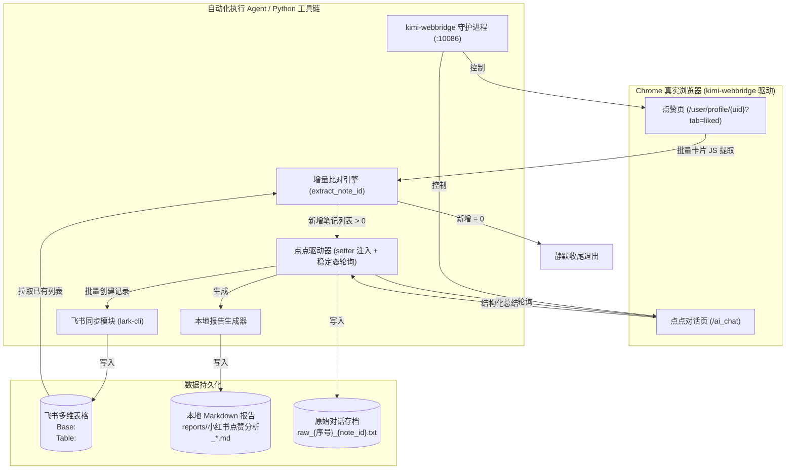

# 项目总览 · 小红书点赞分析

> **项目名称**：小红书点赞分析（xhs-likes-analysis）  
> **所属仓库**：Obsidian Work 库子项目（`<PROJECT_DIR>\`）  
> **更新时间**：2026-09-22

---

## 1. 业务背景与目标

用户在日常浏览小红书时会点赞或收藏大量优质短视频、图文笔记（涵盖大模型工具、编程技巧、逻辑思维题、学生/教师福利、薅羊毛省钱攻略等）。然而这些内容往往分散在平台内，难以检索和持续利用。

本项目旨在实现一个**自动化且低消耗的日常增量总结管道**：
1. 定时拉取用户点赞的最新列表；
2. 自动识别哪些是未处理的新点赞；
3. 驱动小红书官方 AI「点点」阅读并输出结构化总结；
4. 将总结与元数据双向沉淀到飞书多维表格及本地知识库中；
5. 全程轻量，避免不必要的网络开销与页面残留。

---

## 2. 系统架构与数据流图

---

## 3. 核心机制与架构决策

| 机制 / 环节 | 架构决策 | 决策原因与优势 |
|---|---|---|
| **浏览器驱动** | 采用 `kimi-webbridge` 守护进程驱动用户既有 Chrome | 彻底免去 Cookie 模拟登录、短信验证与拼图滑块破解，完全继承用户已有登录态。 |
| **列表抓取** | 单次 `evaluate` 获取全部卡片，禁止逐个点击详情页 | 逐个进详情页容易触发小红书的反爬风控（404 或频繁滑动验证码），且极其缓慢；列表页卡片 DOM 已包含完整元数据。 |
| **链接反爬突破** | 必须提取 `xsec_token` 构成完整 URL | 小红书当前严格限制纯 `/explore/{id}` 形式访问；缺少 `xsec_token` 时，点点 AI 会直接返回 `NOT_FOUND`。 |
| **DOM 文字注入** | 原生 `Object.getOwnPropertyDescriptor` + `InputEvent` 触发 | 点点基于 React/Vue 受控组件，常规 `.value = ...` 或键盘 type 容易丢字或无法更新 internal state。 |
| **流式完成判定** | 文本长度窗口稳定法（连续 2~3 次轮询长度不变且 > 30 字） | 点点为打字机流式输出，若仅监听元素存在容易抓取到半截不完整文字。 |
| **多维表格写入** | 使用 Python `subprocess` 调用 `lark-cli`，JSON Payload 存文件传参 | 避开 Windows PowerShell 对中文引号与换行符的二次转义破坏。 |

---

## 4. 关键资产与路径清单

* **主账号 UID**：`<XHS_USER_ID>`
* **飞书多维表格**：
  * Base Token: `<FEISHU_BASE_TOKEN>`
  * Table ID: `<FEISHU_TABLE_ID>`
* **本地路径**：
  * 项目根目录：`<PROJECT_DIR>\`
  * 脚本目录：`<PROJECT_DIR>\scripts\`
  * 历史报告：`<PROJECT_DIR>\reports\`
  * 原始文本归档：`D:\workbuddy 工作空间\点点分析结果\raw_YYYYMMDD\`
